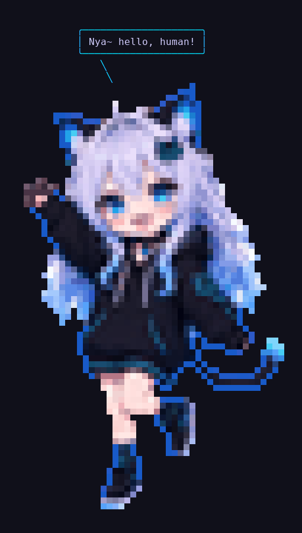
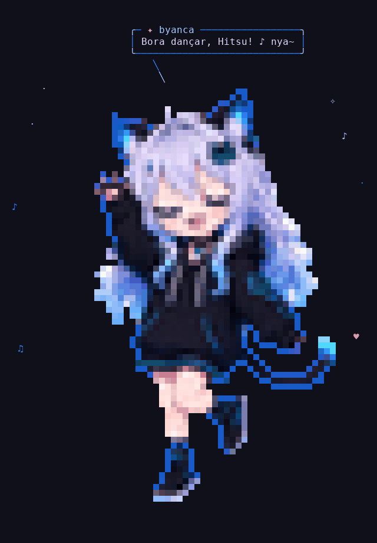
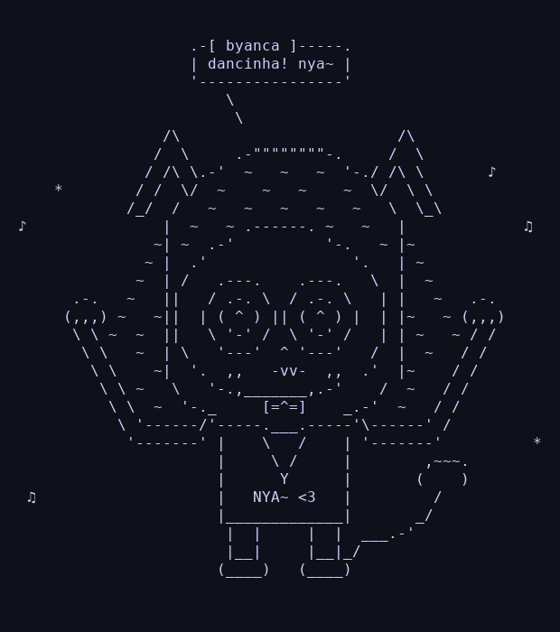
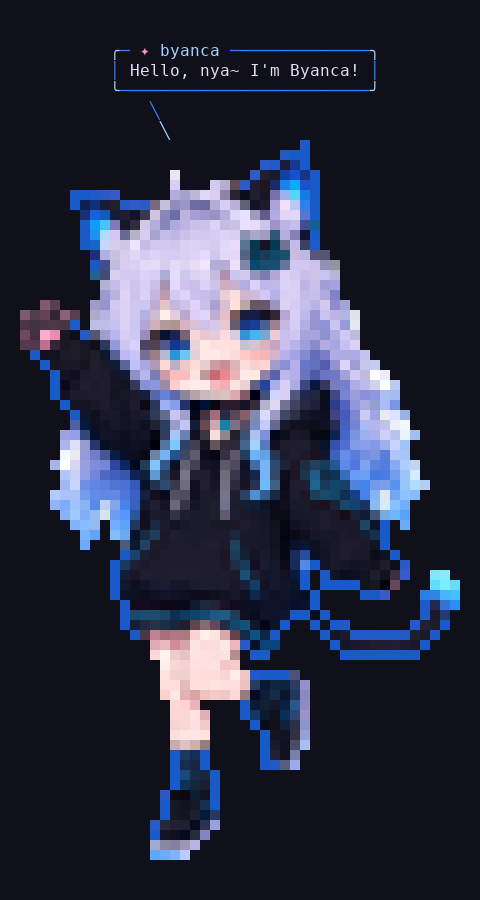
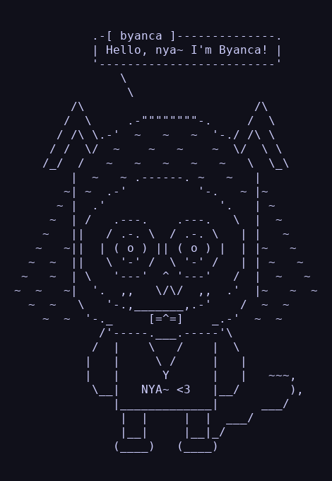

# byancasay

`cowsay`, but it's **Byanca**, a cyberpunk neko with lavender-silver hair,
blue tips, a black hoodie and way too much electric-blue neon. She talks, blinks,
waves her paw, wags her tail and now **dances** right in your terminal.



<p>
  
  
</p>

<p>
  
  
</p>

## Features

- `say`: Byanca says (or thinks) anything, from arguments or piped stdin, with word wrap
- `animate`: in-place animation with blinking eyes, a waving paw and a wagging tail
- `dance` (alias `dancinha`): an 8-frame dance loop (sway, bounce, paws up on the
  beat, tail swinging, happy eyes) with music notes and neon sparkles floating around her
- `freestyle`: keeps switching between random animations, optionally with random quotes (made for ricing)
- Two art styles:
  - a **truecolor half-block chibi** (`▀`/`▄` + 24-bit color, with a 256-color fallback)
  - a **hand-drawn plain-ASCII Byanca** (`--ascii`) that works in any terminal
- Neon `cyber` speech bubbles by default (`--style classic` / `minimal` too) and a colored `--help`
- Auto-detects truecolor, respects [`NO_COLOR`](https://no-color.org) and falls back to ASCII when color is off
- Single self-contained binary: every frame is embedded at compile time
- Nix flake with `packages`, `apps`, an overlay and a dev shell

## Install

### Cargo

```sh
cargo install --path .
```

### Nix (one-off)

```sh
nix run . -- say "Hello, nya~"
# once it lives on GitHub:
nix run github:fabvarisco/byancasay -- say "Hello, nya~"
```

### Nix flake input (home-manager)

```nix
# flake.nix
{
  inputs = {
    nixpkgs.url = "github:NixOS/nixpkgs/nixos-unstable";
    home-manager.url = "github:nix-community/home-manager";
    byancasay.url = "github:fabvarisco/byancasay";
    # or a local checkout: byancasay.url = "path:/home/you/byancasay";
    byancasay.inputs.nixpkgs.follows = "nixpkgs";
  };

  outputs = { nixpkgs, home-manager, byancasay, ... }: {
    homeConfigurations.you = home-manager.lib.homeManagerConfiguration {
      pkgs = nixpkgs.legacyPackages.x86_64-linux;
      extraSpecialArgs = { inherit byancasay; };
      modules = [ ./home.nix ];
    };
  };
}
```

```nix
# home.nix
{ pkgs, byancasay, ... }: {
  home.packages = [ byancasay.packages.${pkgs.stdenv.hostPlatform.system}.default ];
}
```

If you pass `inputs` through `extraSpecialArgs` instead, use
`inputs.byancasay.packages.${pkgs.system}.default`. There is also an overlay:
`nixpkgs.overlays = [ byancasay.overlays.default ];` then `pkgs.byancasay`.

## Usage

```sh
byancasay say "Hello, nya~"            # speech bubble
byancasay say -t "hmm..."              # thought bubble
fortune | byancasay say -w 30          # read from stdin, wrap at 30 columns
byancasay say -w 0 "never wrap this"   # no wrapping
byancasay say --ascii "plain ASCII"    # hand-drawn ASCII art, no color
byancasay                              # a random Byanca quote

byancasay animate                      # wave (default), quit with q, Esc or Ctrl+C
byancasay animate -a wag "Nya~"        # tail wag with a speech bubble
byancasay animate -a party --fps 12    # everything at once
byancasay animate -d 3                 # stop after 3 seconds (nice in a shell greeting)
byancasay freestyle --quotes -i 4      # random animation + quote every 4 seconds

byancasay dance                        # dancinha! (same as: animate --anim dance)
byancasay dance "♪ nya nya ♪"          # dancing with a speech bubble
byancasay dance --ascii -d 5           # the hand-drawn ASCII dance, for 5 seconds
byancasay animate --anim dance --fps 12
```

Animations: `wave`, `wag`, `idle`, `party`, `dance` (`--animation` also answers
to `--anim`). In ASCII mode the paw wave becomes an ear twitch and the mouth
moves while she talks; the ASCII dance raises her paws `\( ^ )/`, sways her body
and head and swings her tail. `freestyle` picks `dance` too.

### Bubble style

| Option | Look |
| --- | --- |
| `--style cyber` (default) | rounded neon box: electric-blue frame, ice-blue corners, a `✦ byanca` tag and lavender-silver text. In ASCII: `.-[ byanca ]-.` |
| `--style classic` | the original rounded cyan box (cowsay `< >` borders in ASCII) |
| `--style minimal` | no box, just a neon bar next to the text |

`--style` works with every command (`say`, `animate`, `dance`, `freestyle`).
With `--ascii`, `--color never` or `NO_COLOR` every style stays plain ASCII
without escape codes.

### Color

| Option | Meaning |
| --- | --- |
| `--color auto` (default) | color on a terminal; truecolor when `COLORTERM=truecolor`/`24bit`, Windows Terminal (`WT_SESSION`), kitty, WezTerm, Alacritty, Ghostty, foot, iTerm2, VS Code...; otherwise 256 colors |
| `--color always` | color even when piped |
| `--color truecolor` / `--color 256` | force a color depth |
| `--color never` or `NO_COLOR=1` | no color, uses the ASCII art |
| `--ascii` | always the plain ASCII art |

The chibi is 48 columns wide and 36 rows tall (plus the bubble), so animations
want a terminal of at least about 50x42; the dance needs about 62x42 because she
sways and the notes float around her (ASCII dance: about 60x31). They are
centered and redraw only the rows that change.

### Shell greeting

```sh
# ~/.zshrc or ~/.bashrc
command -v byancasay >/dev/null && byancasay say "Welcome back, nya~"
```

## Regenerating the art

The chibi frames live in `assets/chibi.bin` and are generated from the original
sticker PNG by `tools/gen_chibi.py`. It removes the white sticker border and
the floating hearts, builds blink / wave / tail variants (27 frames), downsamples
them to 48x72 pixels and adds a thin neon rim so the black hoodie reads on dark
terminals. It also renders the 8 dance frames (whole-body sway around the feet,
bounce with a little squash, paw pumping, tail swing, happy eyes; see the
`DANCE` table) into a second block of the same file at the same scale:

```sh
nix develop   # cargo, clippy, python with pillow + numpy
python3 tools/gen_chibi.py path/to/byanca_chibi_oi.png --width 48 --out assets/chibi.bin --preview /tmp/frames
cargo build --release
```

The ASCII frames are plain text in `assets/ascii/` (the base drawing plus two
tail poses). Blinks, ear twitches, the talking mouth and the dance (raised paws,
sway, head tilt, bounce) are applied in code, and the music notes are drawn
only on empty cells so they never cover the art.

`tools/render_preview.py` turns terminal output (or a `script` recording) into
the PNG/GIF previews in `docs/` (needs `pillow` and `pyte`).

## Development

```sh
nix develop
cargo test
cargo clippy --all-targets
nix build && ./result/bin/byancasay
```

## Credits

Inspired by [cowsay](https://en.wikipedia.org/wiki/Cowsay) and
[momoisay](https://github.com/haruki-nikaidou/momoisay-rs). byancasay is an
independent implementation written from scratch; no code or art was copied.

## License

[MIT](LICENSE) © 2026 Fabricio Varisco
